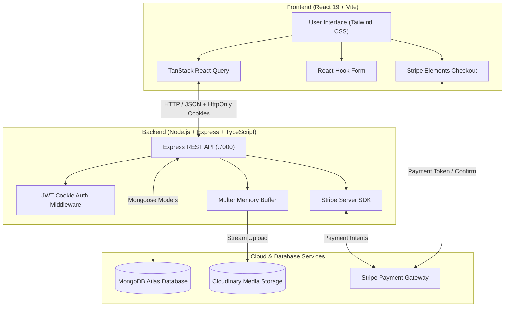

# 🏨 Hotel Booking & Reservation System

<p align="center">
  
</p>

<p align="center">
  A production-ready, full-stack hotel booking and property management web application built with <strong>TypeScript</strong>, <strong>React</strong>, <strong>Node.js</strong>, <strong>Express</strong>, <strong>MongoDB</strong>, <strong>Tailwind CSS</strong>, <strong>Cloudinary</strong>, <strong>Stripe</strong>, and <strong>Playwright</strong>.
</p>

<p align="center">
  <a href="#-key-features">Key Features</a> •
  <a href="#-tech-stack">Tech Stack</a> •
  <a href="#-system-architecture">Architecture</a> •
  <a href="#-project-structure">Project Structure</a> •
  <a href="#-getting-started">Getting Started</a> •
  <a href="#-api-documentation">API Reference</a> •
  <a href="#-e2e-testing">Testing</a> •
  <a href="#-license">License</a>
</p>

<p align="center">
  
  
  
  
  
  
  
  
  
  
</p>

---

## 📖 Overview

The **Hotel Booking & Reservation Platform** is a full-featured web solution designed for travelers and hotel owners alike. It provides seamless hotel discovery, fine-grained filtering, real-time booking calculations, and secure credit card payments powered by Stripe. For property owners, it includes a comprehensive management dashboard with multi-photo uploads directly to Cloudinary and complete listing control.

---

## ✨ Key Features

### 👤 Guest Experience

- **Secure Authentication & Sessions**: Complete registration and login flows with password hashing (`bcryptjs`) and secure, HTTP-only JWT cookies.
- **Dynamic Search & Filtering Engine**:
  - Filter by **destination** (city or country search with regex).
  - Filter by **guest occupancy** (adults and children).
  - Filter by **hotel type** (Luxury, Boutique, Ski Resort, Budget, Beach Resort, etc.).
  - Filter by **star rating** (1 to 5 stars).
  - Filter by **facilities** (Free WiFi, Parking, Airport Shuttle, Pool, Spa, Fitness Center, etc.).
  - Filter by **price range** (slider / max price selector).
  - Sort results by price (low-to-high, high-to-low) or star ratings.
  - Paginated search results for high performance.
- **Detailed Hotel Overview**: Photo galleries, amenities display, transparent pricing per night, and guest capacity.
- **Live Booking & Payment Flow**:
  - Interactive date pickers for Check-in and Check-out.
  - Automatic total nights and total cost calculation.
  - Embedded **Stripe Elements** payment intent checkout with client-server status confirmation.

### 🏨 Host & Hotel Management

- **List New Hotels**:
  - Multi-section form (`react-hook-form`) with real-time validation.
  - Multi-image uploads (up to 6 files per property) via `multer` memory storage and Cloudinary transformations.
  - Configurable amenities, types, rates, and occupancy rules.
- **Manage Existing Properties**:
  - View all properties created by the signed-in host.
  - Edit hotel info, adjust prices, change amenities, and manage existing/new photo URLs.

### 🛡️ Quality & Architecture

- **End-to-End Testing**: Automated test coverage using **Playwright** covering authentication, hotel management, and search suites.
- **Type-Safe Full Stack**: Shared TypeScript interfaces across client and server.
- **Optimized Data Fetching**: Utilizes **TanStack React Query** for automatic caching, refetching, and query invalidation.
- **Responsive Layout**: Designed mobile-first using **Tailwind CSS**.

---

## 🛠️ Tech Stack

### Frontend

- **Framework**: [React 19](https://react.dev/) + [TypeScript](https://www.typescriptlang.org/)
- **Bundler & Build Tool**: [Vite](https://vitejs.dev/)
- **Styling**: [Tailwind CSS](https://tailwindcss.com/), [PostCSS](https://postcss.org/), [Autoprefixer](https://github.com/postcss/autoprefixer)
- **Data Fetching & Caching**: [@tanstack/react-query](https://tanstack.com/query/latest)
- **Forms & Validation**: [React Hook Form](https://react-hook-form.com/)
- **Routing**: [React Router v6](https://reactrouter.com/)
- **Payments**: [@stripe/react-stripe-js](https://stripe.com/docs/stripe-js/react) & [@stripe/stripe-js](https://stripe.com/docs/js)
- **UI Components & Icons**: [React Icons](https://react-icons.github.io/react-icons/), [React Datepicker](https://reactdatepicker.com/)

### Backend

- **Runtime & Framework**: [Node.js](https://nodejs.org/) & [Express.js](https://expressjs.com/) (TypeScript)
- **Database & ODM**: [MongoDB](https://www.mongodb.com/) via [Mongoose](https://mongoosejs.com/)
- **Authentication**: [JSON Web Token (JWT)](https://jwt.io/), [bcryptjs](https://github.com/dcodeIO/bcrypt.js), `cookie-parser`
- **Validation**: [express-validator](https://express-validator.github.io/)
- **File Uploads & Media CDN**: [Multer](https://github.com/expressjs/multer) & [Cloudinary SDK v2](https://cloudinary.com/)
- **Payments Integration**: [Stripe Node SDK](https://stripe.com/docs/api)
- **CORS & Environment**: `cors`, `dotenv`, `cross-env`

### Testing & Tooling

- **End-to-End Tests**: [Playwright](https://playwright.dev/) (Chrome, Firefox, Safari WebKit)
- **Development Tooling**: `nodemon`, `ts-node`, `eslint`

---

## 🏗️ System Architecture



---

## 📂 Project Structure

```plaintext
hotel-booking/
├── backend/
│   ├── src/
│   │   ├── middleware/
│   │   │   └── auth.ts                # JWT authentication & cookie verification
│   │   ├── models/
│   │   │   ├── hotel.ts               # Mongoose schema for hotels & bookings
│   │   │   └── user.ts                # Mongoose schema for users & credentials
│   │   ├── routes/
│   │   │   ├── auth.ts                # Login, logout & token validation
│   │   │   ├── hotels.ts              # Search, filter, hotel details & payments
│   │   │   ├── my-hotels.ts           # Property listing CRUD & image upload
│   │   │   └── users.ts               # User registration & profile retrieval
│   │   ├── shared/
│   │   │   └── types.ts               # Shared TypeScript schemas & payloads
│   │   └── index.ts                   # Express application entry & configuration
│   ├── .env.example                   # Backend environment template
│   ├── package.json
│   └── tsconfig.json
│
├── frontend/
│   ├── src/
│   │   ├── assets/                    # Images, SVGs, and brand banners
│   │   ├── components/                # SearchBar, Filters, Pagination, Navbar, etc.
│   │   ├── config/                    # Hotel options, facilities, & types config
│   │   ├── contexts/                  # AppContext (auth/toast) & SearchContext
│   │   ├── forms/                     # ManageHotelForm, BookingForm, GuestInfoForm
│   │   ├── layouts/                   # Global header/footer layout wrappers
│   │   ├── pages/                     # Search, Detail, Booking, Add/Edit Hotel, Auth
│   │   ├── api-client.ts              # Typed frontend API client methods
│   │   ├── App.tsx                    # Route definitions & protected routes
│   │   └── main.tsx                   # Vite React root mount
│   ├── .env.example                   # Frontend environment template
│   ├── package.json
│   ├── tailwind.config.js
│   └── vite.config.ts
│
├── e2e-tests/
│   ├── tests/
│   │   ├── auth.spec.ts               # Login / registration E2E assertions
│   │   ├── manage-hotels.spec.ts      # Add / edit hotel E2E flow
│   │   └── search-hotel.spec.ts       # Search, filter, and pagination assertions
│   ├── playwright.config.ts           # Playwright cross-browser setup
│   └── package.json
│
├── .gitignore
└── README.md
```

---

## 🚀 Getting Started

Follow the instructions below to run the application locally on your machine.

### 📋 Prerequisites

Make sure you have the following installed:

- [Node.js](https://nodejs.org/) (v18.x or v20.x recommended)
- [npm](https://www.npmjs.com/) or [yarn](https://yarnpkg.com/)
- [MongoDB](https://www.mongodb.com/) (Local instance or free [MongoDB Atlas](https://www.mongodb.com/atlas) cluster)
- Free accounts on [Cloudinary](https://cloudinary.com/) (for image uploads) and [Stripe](https://stripe.com/) (for test payments)

---

### 1️⃣ Clone the Repository

```bash
git clone https://github.com/Aasutosh23/hotel-booking.git
cd hotel-booking
```

---

### 2️⃣ Configure & Run Backend

1. Navigate to the backend directory and install dependencies:

   ```bash
   cd backend
   npm install
   ```

2. Create your `.env` file based on `.env.example`:

   ```bash
   cp .env.example .env
   ```

3. Fill in your environment variables in `backend/.env`:

   ```env
   PORT=7000
   FRONTEND_URL=http://localhost:5173
   MONGODB_CONNECTION_STRING=your_mongodb_connection_string
   JWT_SECRET_KEY=your_super_secret_jwt_key
   CLOUDINARY_CLOUD_NAME=your_cloudinary_cloud_name
   CLOUDINARY_API_KEY=your_cloudinary_api_key
   CLOUDINARY_API_SECRET=your_cloudinary_api_secret
   STRIPE_API_KEY=sk_test_your_stripe_secret_key
   ```

4. Start the backend development server:
   ```bash
   npm run dev
   ```
   > The server will start on `http://localhost:7000`.

---

### 3️⃣ Configure & Run Frontend

1. Open a new terminal, navigate to the frontend directory, and install dependencies:

   ```bash
   cd frontend
   npm install
   ```

2. Create your `.env` file based on `.env.example`:

   ```bash
   cp .env.example .env
   ```

3. Fill in your environment variables in `frontend/.env`:

   ```env
   VITE_API_BASE_URL=http://localhost:7000
   VITE_STRIPE_PUB_KEY=pk_test_your_stripe_publishable_key
   ```

4. Start the Vite development server:
   ```bash
   npm run dev
   ```
   > The client will start on `http://localhost:5173`.

---

## ⚙️ Environment Variables Summary

### Backend (`backend/.env`)

| Variable                    | Description                              | Example                 |
| :-------------------------- | :--------------------------------------- | :---------------------- |
| `PORT`                      | Port the Express server listens on       | `7000`                  |
| `FRONTEND_URL`              | Client origin URL for CORS policy        | `http://localhost:5173` |
| `MONGODB_CONNECTION_STRING` | MongoDB Atlas or local connection string | `mongodb+srv://...`     |
| `JWT_SECRET_KEY`            | Secret key used to sign JWT auth cookies | `my_jwt_random_secret`  |
| `CLOUDINARY_CLOUD_NAME`     | Cloudinary account cloud name            | `your_cloud_name`       |
| `CLOUDINARY_API_KEY`        | Cloudinary API Key                       | `1234567890`            |
| `CLOUDINARY_API_SECRET`     | Cloudinary API Secret                    | `your_api_secret`       |
| `STRIPE_API_KEY`            | Stripe Secret API Key (test or live)     | `sk_test_...`           |

### Frontend (`frontend/.env`)

| Variable              | Description                                | Example                 |
| :-------------------- | :----------------------------------------- | :---------------------- |
| `VITE_API_BASE_URL`   | Express API endpoint URL                   | `http://localhost:7000` |
| `VITE_STRIPE_PUB_KEY` | Stripe Publishable Key for client Elements | `pk_test_...`           |

---

## 📡 API Reference

### 🔐 Authentication (`/api/auth`)

| Method | Endpoint                   | Access | Description                                          |
| :----- | :------------------------- | :----- | :--------------------------------------------------- |
| `POST` | `/api/auth/login`          | Public | Authenticates user; issues HTTP-only JWT cookie      |
| `GET`  | `/api/auth/validate-token` | Public | Validates active session cookie and returns `userId` |
| `GET`  | `/api/auth/logout`         | Public | Clears `auth_token` cookie                           |

### 👤 User Management (`/api/users`)

| Method | Endpoint              | Access  | Description                                          |
| :----- | :-------------------- | :------ | :--------------------------------------------------- |
| `POST` | `/api/users/register` | Public  | Registers a new user account and sets session cookie |
| `GET`  | `/api/users/me`       | Private | Returns current user profile without password        |

### 🏨 Hotel Management - Host (`/api/my-hotels`)

| Method | Endpoint                  | Access  | Description                                                |
| :----- | :------------------------ | :------ | :--------------------------------------------------------- |
| `POST` | `/api/my-hotels`          | Private | Creates a hotel listing with multi-image Cloudinary upload |
| `GET`  | `/api/my-hotels`          | Private | Retrieves all hotel listings owned by the logged-in user   |
| `GET`  | `/api/my-hotels/:id`      | Private | Retrieves specific hotel listing details by ID             |
| `PUT`  | `/api/my-hotels/:hotelId` | Private | Updates hotel details, facilities, pricing, or photos      |

### 🔍 Search & Bookings (`/api/hotels`)

| Method | Endpoint                                              | Access  | Description                                                          |
| :----- | :---------------------------------------------------- | :------ | :------------------------------------------------------------------- |
| `GET`  | `/api/hotels/search`                                  | Public  | Filtered & paginated search (destination, dates, stars, price, type) |
| `GET`  | `/api/hotels/:id`                                     | Public  | Fetches individual hotel public view by ID                           |
| `POST` | `/api/hotels/:hotelId/bookings/create-payment-intent` | Private | Generates Stripe payment intent client secret                        |
| `POST` | `/api/hotels/:hotelId/bookings`                       | Private | Finalizes booking after payment succeeds                             |

---

## 🧪 E2E Testing

End-to-end tests are written with [Playwright](https://playwright.dev/) to simulate actual user workflows across Chromium, Firefox, and WebKit.

1. Navigate to the tests directory:

   ```bash
   cd e2e-tests
   npm install
   ```

2. Run the tests in headless mode:

   ```bash
   npm test
   ```

3. Run tests with the interactive UI:

   ```bash
   npm run test:ui
   ```

4. Debug test runs:
   ```bash
   npm run test:debug
   ```

> [!NOTE]  
> Make sure both the backend (in E2E mode with `npm run e2e`) and frontend (`npm run dev`) are running before executing the test suites.

---

## 📦 Production Build & Deployment

To build the project for production:

1. **Build Frontend**:

   ```bash
   cd frontend
   npm run build
   ```

   This generates an optimized production bundle inside `frontend/dist`.

2. **Build Backend**:

   ```bash
   cd backend
   npm run build
   ```

   This compiles TypeScript files into `backend/dist`.

3. **Start Production Server**:
   ```bash
   cd backend
   npm start
   ```
   The Express server serves the compiled frontend static files from `frontend/dist` and handles API requests on port `7000` (or `process.env.PORT`).

---

## 🤝 Contributing

Contributions, issues, and feature requests are welcome!
Feel free to check the [issues page](https://github.com/Aasutosh23/hotel-booking/issues).

1. Fork the Project
2. Create your Feature Branch (`git checkout -b feature/AmazingFeature`)
3. Commit your Changes (`git commit -m 'Add some AmazingFeature'`)
4. Push to the Branch (`git push origin feature/AmazingFeature`)
5. Open a Pull Request

---

## 📝 License

This project is licensed under the **ISC License**. Feel free to use and modify it for your own projects.
